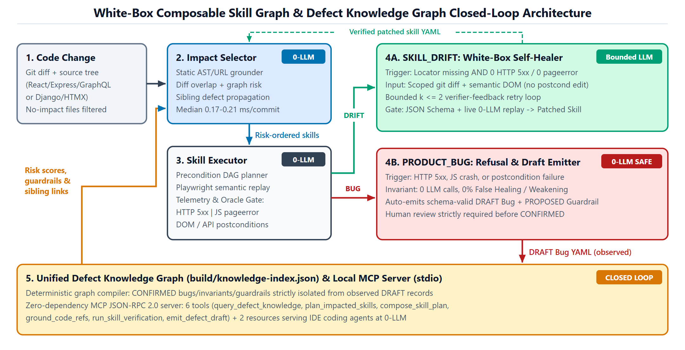

# White-Box Composable Skill Graph Platform

**White-Box Composable Skill Graphs with Defect Knowledge Feedback for Safe, Zero-LLM-Replay Web Verification**

A deterministic closed-loop web verification platform uniting:
- **White-Box Composable Skill Graph (`packages/skill-graph/`):** Schema-validated atomic UI skills (`skills/`), precondition DAG planning, `0-LLM` static AST/URL route-to-code grounding (React/Express/GraphQL + Django/HTMX), deterministic 3-way Telemetry Oracle (`VERIFIED_PASS` / `SKILL_DRIFT` / `PRODUCT_BUG`), bounded `k <= 2` scoped `git diff`-guided self-healing with hard `0-LLM` product-bug refusal, and generalization-gated skill authoring.
- **Deterministic Defect Knowledge Graph (`packages/knowledge-validator/`, `knowledge/`, `contracts/knowledge/`):** Version-controlled defect families, domain invariants, executable `SKILL_GRAPH_VERIFIER` guardrails, and strict provenance isolation preventing machine-emitted `DRAFT` defects from self-promoting to `CONFIRMED`.
- **Zero-Dependency Local MCP Server (`packages/mcp-server/`):** JSON-RPC 2.0 `stdio` server exposing 6 tools (`query_defect_knowledge`, `plan_impacted_skills`, `compose_skill_plan`, `ground_code_refs`, `run_skill_verification`, `emit_defect_draft`) and 2 catalog resources to AI coding agents at `0-LLM` (`$0.00`).
- **IEEE & Capstone Evaluation Suite (`benchmarks/skill-graph/`, `docs/`):** `EvoBench-48` (`48` commits), `RealGit-99` (`99` real upstream Git commits), 3-family LLM generalization panel (`DeepSeek-V3.2`, `Gemini-2.5-Flash`, `GPT-4o-mini`), exact statistical significance engine (Wilson 95% CIs, Exact McNemar, Fisher's Exact, Mann-Whitney $U$, Cliff's $\delta$), Overleaf-ready IEEE paper (`docs/ieee-paper/`), and Vietnamese Capstone Thesis docs (`docs/thesis-vi/`).

---

## Architecture Overview



---

## Headline Empirical Results

| Evaluation Dimension | Key Verified Result | Statistical / Ablation Context |
|---|---|---|
| **RQ1: Cost & Speed (`0-LLM` Replay)** | **25/25 (100%)** pass at **5.07 s/run** (median `4.47 s`) vs. Pure-LLM **11/15 (73.3%)** at **102.34 s/run** (**20.2x speedup**) | Fisher `p = 0.015` (pass rate); MW `U = 0, p < 0.001`, Cliff's `delta = -1` (large); **-88.2%** cost at `N=5`, **-98.5%** at `N=100` |
| **RQ2: `EvoBench-48` (`N = 48`)** | **16/16 (100.0%)** Drift Recovery; **0/20 (0%)** Attempted Weakening & False Healing (`0` LLM calls on bugs); **80.74%** test reduction | Exact McNemar `p < 0.001` vs. Static, `p = 0.0078` vs. Black-Box (`50.0%`); Fisher `p < 0.001` vs. Black-Box weakening (`12/20 = 60%`, 1 live False Heal) |
| **RQ3: 3-Model Generalization** | **24/24 (100%)** White-Box DRR & **0/12 (0%)** FHR across `DeepSeek-V3.2`, `Gemini-2.5-Flash`, `GPT-4o-mini` | Model-agnostic safety invariant; cheapest WB heal cost `$0.0038` for 8 drifts (`GPT-4o-mini`); Black-Box caused live False Heal on `Gemini-2.5-Flash` |
| **RQ4: `RealGit-99` (`0-LLM`)** | **92/99 (92.9%)** real upstream commits skipped; **98.5%** overall test reduction (`99.7%` RWA, `96.0%` Horilla) | Sub-millisecond selection latency (`0.17-0.21 ms/commit` median) |
| **RQ5: Grounding & MCP Closed Loop** | Static `codeRefs` precision **25% -> 81%**; Authoring **75% -> 100%**; Top-1 Risk Accuracy **50% -> 100%**; Sibling Recall **0% -> 100%** | Live `stdio` MCP closed loop verified on both React/Express and Django/HTMX at `$0.00` |

---

## Quick Start (100% Offline, `0-LLM`, `$0.00`)

```bash
npm ci
npm run typecheck
npm test
npm run knowledge:validate
npm run knowledge:build

# Run the 4-stage live offline defense demo (~2s, 0-LLM, $0.00)
npm run demo:defense
```

### Connecting to an IDE / AI Coding Agent via MCP (`stdio`)

```json
{
  "mcpServers": {
    "whitebox-skill-graph": {
      "command": "npm",
      "args": ["run", "mcp", "--silent"],
      "cwd": "<path-to-whitebox-skill-graph-platform>"
    }
  }
}
```

---

## Repository Structure

```text
├── benchmarks/skill-graph/   # EvoBench-24/48, RealGit-99, Pure-LLM & ablations, stats & SVG compiler
├── contracts/
│   ├── knowledge/            # JSON Schemas for defect families, invariants, guardrails, bugs
│   └── skill-graph/          # JSON Schema + positive/negative fixtures for composable skills
├── docs/
│   ├── ieee-paper/           # Overleaf-ready IEEEtran paper (main.tex, references.bib, figures/*.{svg,pdf,png})
│   ├── thesis-evaluation/    # Verified CSV datasets, Markdown reports, and IEEE booktabs LaTeX tables
│   └── thesis-vi/            # Vietnamese Capstone Thesis outline, Chapter 4 draft, and 5-min defense Q&A
├── knowledge/                # Open-source defect families, invariants (INV-RWA-001, INV-HOR-001), guardrails
├── packages/
│   ├── knowledge-validator/  # Zero-remote-ref schema validator & deterministic graph compiler
│   ├── skill-graph/          # Planner, Playwright executor, static grounder, healer, author, knowledge bridge
│   └── mcp-server/           # Zero-dependency JSON-RPC 2.0 stdio MCP server
├── scripts/                  # Offline defense demo, IEEE figure exporter, and live benchmark runners
└── skills/                   # Validated atomic skills for cypress-realworld-app (8) & horilla (4)
```

---

## Reproducing Live Benchmarks (Optional)

Live browser benchmarks target unmodified checkouts of `cypress-io/cypress-realworld-app` and `horilla-opensource/horilla` placed under `runtime/sandboxes/` with a transient `OPENROUTER_API_KEY`:

```powershell
# Regenerate all 5 IEEE figures (SVG + vector PDF + 300-DPI PNG, 0-LLM)
npm run figures:export

# Run Phase C benchmarks (requires local SUT servers + transient OPENROUTER_API_KEY)
$env:OPENROUTER_API_KEY = "<your-openrouter-key>"
npx tsx scripts/skill-graph-phase-c-benchmark.ts --stage all --export
```
